<picture>
  <source media="(prefers-color-scheme: dark)" srcset="koi/intro-dark.svg" />
  
</picture>

## My projects:

| Personal | Hackathons | Games |
| :---: | :---: | :---: |
| [LumaCaption](https://github.com/Pavi21P/lumacaption) | [Quiz Companion](https://github.com/Pavi21P/study-companion) | [Coin Catchers](https://github.com/Pavi21P/coin-catchers) |
| [UHD Student Extension](https://github.com/Pavi21P/uhd-student-extension) | [RefIt](https://github.com/Pavi21P/RefIt) | |
| [Personal Homepage (CS4300)](https://github.com/Pavi21P/personal-homepage) | | |
| [UHD Course Planner](https://github.com/Pavi21P/uhd-course-planner) | | |
| [UHD ACM Discord Bot](https://github.com/Pavi21P/UHD-ACM-Discord-Bot) | | |

#### Check out my LinkedIn:

[Pavitra Patil](https://www.linkedin.com/in/pavitra-patil-5a18712aa/)
